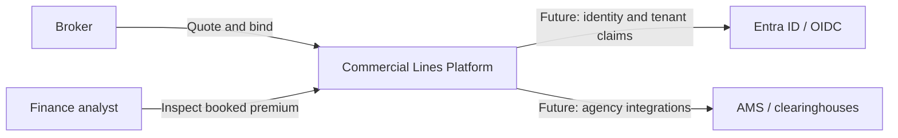

# System context

The learning scope demonstrates the Commercial Property path from schedule submission through quote, bind, and auditable premium booking. External identity and agency integrations are future concerns, represented in the Azure and integration architecture rather than implemented in the MVP.
