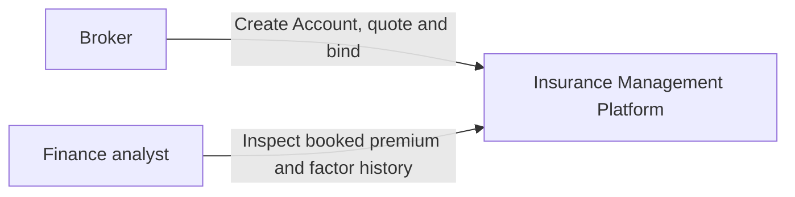

# System context

This view shows the learning system's current scope and the people who use it. External identity and agency integrations are deferred and are not part of this context boundary.

The learning scope demonstrates the Commercial Property path from schedule submission through quote and bind to auditable premium booking. The platform is an architecture exercise, not a claim of broad, production-ready insurance management capability. Its four contexts are Policy, Rules, Rating, and Ledger; see the [container view](02-containers.md) for their responsibilities and interactions.
