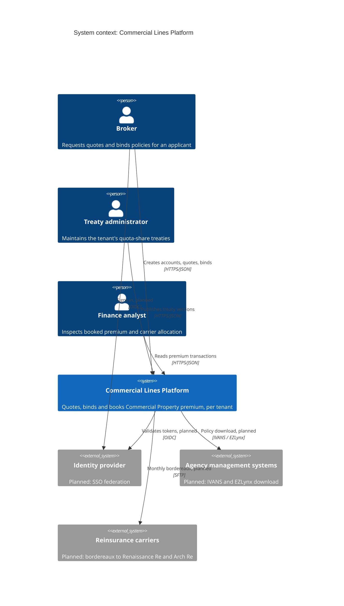

# System context

Structurizr view: `SystemContext`.

The Commercial Lines Platform lets brokers quote and bind Commercial Property policies for a tenant (a program organisation), books the bound premium to an immutable ledger, and allocates it to reinsurance carriers under the tenant's quota-share treaty.

## Scope

| In the MVP | Planned, outside the MVP |
| --- | --- |
| Quote, bind and booking for Commercial Property, NAICS 531110 and 722511 | Endorsements, cancellations, renewals |
| Rules and Rating with one published version each | Underwriter workbench for referrals |
| Quota-share treaties with Renaissance Re and Arch Re | Bordereaux delivery to carriers |
| Tenant isolation via `X-Tenant-Id` | SSO federation, per-user authorisation |
| Immutable premium ledger with factor and allocation lines | Billing, payments, documents |
| | AMS connectivity, third-party enrichment, FCRA credit |

Each planned item has a row in [../../specs/traceability.md](../../specs/traceability.md).

## What each box is

| Box | What it is |
| --- | --- |
| Broker | A person at a producing agency. Creates Accounts, requests Quotes and binds Policies. Talks only to Policy. |
| Treaty administrator | Maintains the tenant's quota-share treaties and publishes Treaty Versions. Talks only to Carrier. |
| Finance analyst | Reads booked premium and the carrier allocation. Talks only to Ledger. Does not bind and does not change the ledger. |
| Commercial Lines Platform | This system: quote, bind and premium booking for Commercial Property, isolated per Tenant. The next page opens it into services. |
| Identity provider | Planned. The MVP trusts `X-Tenant-Id` at the gateway boundary and does not validate tokens. |
| Agency management systems | Planned. Policy download to IVANS and EZLynx is out of the MVP. |
| Reinsurance carriers | Renaissance Re and Arch Re as organisations that will receive bordereaux. In the MVP they exist only as Carrier records and treaty shares; nothing is sent to them. |
