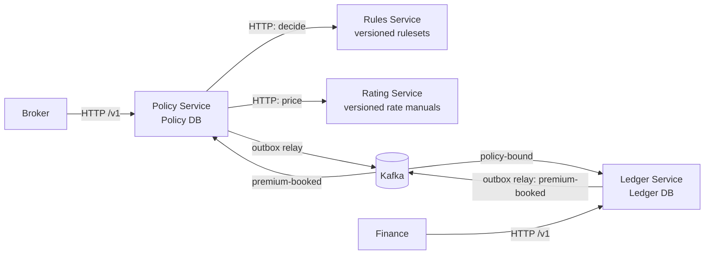

# Container view

| Context | Owns data | Why separate |
| --- | --- | --- |
| Policy | Account, Applicant, Policy schedule/revisions, quote snapshots, bind state, Booking Status | Owns the commercial workflow and contract state |
| Rules | Published eligibility rulesets | Eligibility changes independently from price; no per-quote state |
| Rating | Published rate manuals | Pricing and factor-level explanation are independent from eligibility; no per-quote state |
| Ledger | Premium transactions and lines | Financial records are append-only and independently auditable |

Policy synchronously calls Rules and Rating because a broker needs a Decision and price to receive a Quote. After bind, Policy and Ledger communicate asynchronously. Rules and Rating do not share Policy's database. Ledger owns its own database and consumes a complete bound snapshot; it does not query Policy or Rating while booking.

## Microservice rationale

The stateful split exists where data ownership and transaction boundaries differ: Policy commits policy state; Ledger commits financial state. Rules and Rating are separate stateless contexts because the role explicitly demonstrates the distinction between eligibility decisions and pricing. This is an educational decomposition; a production team should validate operational cost, deployment independence, and scaling needs before choosing the same number of services.
