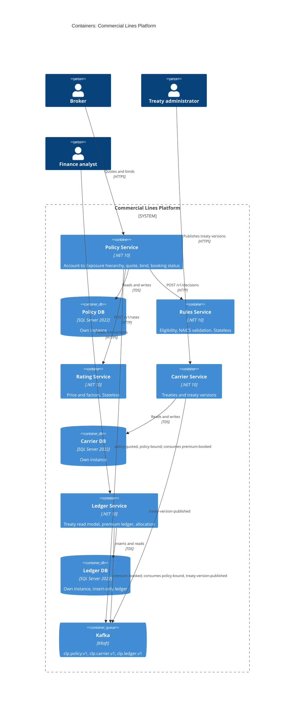

# Containers

Structurizr view: `Containers`. Decisions: [ADR-0001](../adr/0001-database-server-per-stateful-service.md), [ADR-0002](../adr/0002-stateless-rules-and-rating.md), [ADR-0004](../adr/0004-account-inside-policy-service.md), [ADR-0005](../adr/0005-transactional-outbox-and-inbox.md), [ADR-0006](../adr/0006-event-carried-treaty-state.md).

## Ownership

| Container | Owns (only writer) | Reads from others via | Publishes | Consumes |
| --- | --- | --- | --- | --- |
| Policy | Account, Applicant, Policy, Policy Revision and its hierarchy, Decision and Rate Snapshot copies, Booking Status | Rules and Rating APIs (sync) | `policy-quoted.v1`, `policy-bound.v1` | `premium-booked.v1` |
| Rules | Ruleset files, NAICS Extension schemas | none | none | none |
| Rating | Rate Manual files | none | none | none |
| Carrier | Carrier, Treaty, Treaty Version, shares | none | `treaty-version-published.v1` | none |
| Ledger | Premium Transaction and lines; treaty read model (copy) | none | `premium-booked.v1` | `policy-bound.v1`, `treaty-version-published.v1` |

## Communication styles

| Path | Style | Why |
| --- | --- | --- |
| Policy to Rules, Rating | Synchronous HTTP | The broker is waiting for a price; both are stateless and fast |
| Policy to Ledger | Event, via outbox | Booking must not block or fail a bind; Ledger must not depend on Policy being up |
| Carrier to Ledger | Event-carried state | Booking must not depend on Carrier at runtime |
| Ledger to Policy | Event | Policy learns the booking outcome without polling |

The quote and bind path touches only Policy, Rules, Rating and Policy DB. Carrier, Ledger and Kafka can be down without failing a bind; booking catches up when they return.
