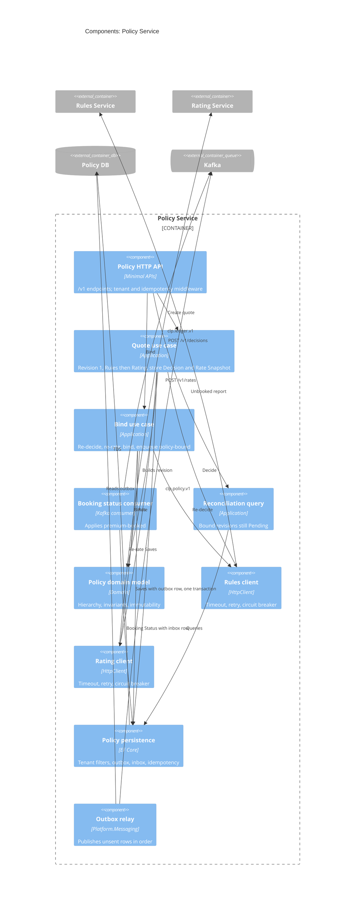
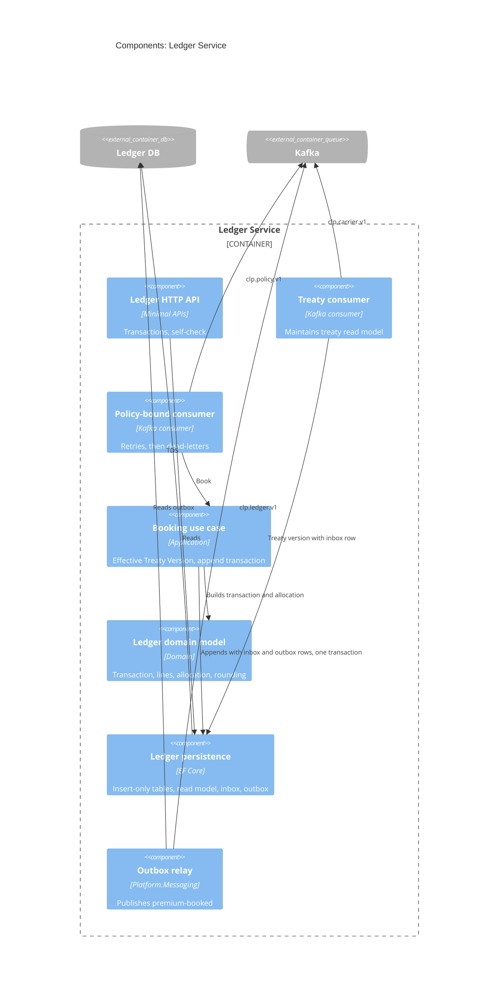

# Components

Structurizr views: `PolicyComponents`, `LedgerComponents`. Rules, Rating and Carrier are simple enough not to need a component view.

Every service uses the same layering: `Api` depends on `Application`, `Application` depends on `Domain` and on ports it defines, `Infrastructure` implements those ports. `Domain` depends on nothing outside the BCL (enforced by architecture tests, NFR-21).

## Policy Service

Project mapping:

| Component | Project |
| --- | --- |
| Policy HTTP API | `Policy.Api` |
| Quote, Bind, Booking status, Reconciliation | `Policy.Application` |
| Policy domain model | `Policy.Domain` |
| Rules and Rating clients, persistence, consumer host | `Policy.Infrastructure` |
| Outbox relay, inbox, idempotency, tenancy | `Platform.*` |

## Ledger Service

### Booking algorithm

1. Inbox check for `(ledger.policy-bound, eventId)`. Seen: acknowledge.
2. Business key check for `(tenantId, policyId, revisionNo, NewBusiness)`. Exists: record inbox row, acknowledge.
3. Select the tenant's Treaty Version for `CP` with the latest `effectiveFrom` on or before the policy `effectiveFrom`. None: throw a retryable error (retries, then dead-letter).
4. For each Exposure: premium line, Factor Lines from the event, Allocation Lines per [the allocation rule](../../specs/product/rules-and-rating.md#quota-share-allocation).
5. Insert transaction, lines, inbox row, `AggregateSequence` increment and `premium-booked` outbox row in one SQL transaction.
