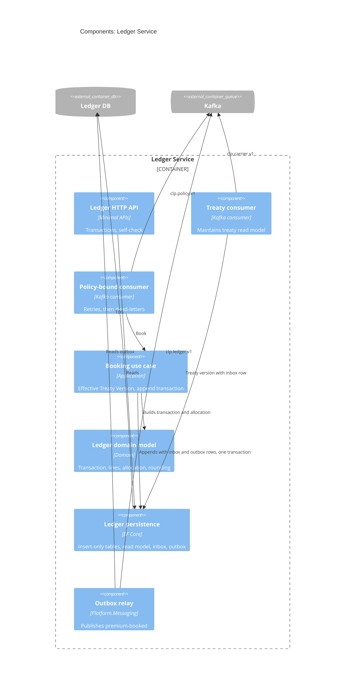

# Components: Ledger Service

Structurizr view: `LedgerComponents`.

## What each box is

| Box | Role |
| --- | --- |
| Ledger HTTP API | Read-only for the finance analyst: premium transactions and the reconciliation self-check. Booking is not an HTTP command; it happens when `policy-bound` arrives. |
| Treaty consumer | Applies `treaty-version-published` to the local treaty read model. Booking then does not call Carrier at runtime. |
| Policy-bound consumer | Hands `policy-bound` to the booking use case. Retries a missing treaty version, then dead-letters to `clp.policy.v1.ledger.dlt`. |
| Booking use case | Picks the Treaty Version effective on the policy's effective date and appends one Premium Transaction with premium, factor and allocation lines. |
| Ledger domain model | Premium Transaction, lines, allocation and the rounding rules. Insert-only: a correction is a new transaction. |
| Ledger persistence | EF Core. Ledger tables reject update and delete. Also holds the treaty read model, inbox and outbox. |
| Outbox relay | Publishes `premium-booked` to `clp.ledger.v1` after the transaction has committed. |
| Ledger DB | This service's own SQL Server. Premium transactions and lines, treaty read model, inbox, outbox. |
| Kafka | Source of `treaty-version-published` and `policy-bound`; destination of `premium-booked`. |

## Booking algorithm

1. Inbox check for `(ledger.policy-bound, eventId)`. Seen: acknowledge.
2. Business key check for `(tenantId, policyId, revisionNo, NewBusiness)`. Exists: record inbox row, acknowledge.
3. Select the tenant's Treaty Version for `CP` with the latest `effectiveFrom` on or before the policy `effectiveFrom`. None: throw a retryable error (retries, then dead-letter).
4. For each Exposure: premium line, Factor Lines from the event, Allocation Lines per [the allocation rule](../../specs/product/rules-and-rating.md#quota-share-allocation).
5. Insert transaction, lines, inbox row, `AggregateSequence` increment and `premium-booked` outbox row in one SQL transaction.

## Project mapping

| Component | Project |
| --- | --- |
| Ledger HTTP API | `Ledger.Api` |
| Treaty consumer, policy-bound consumer, booking | `Ledger.Application` |
| Ledger domain model | `Ledger.Domain` |
| Persistence, consumer host | `Ledger.Infrastructure` |
| Outbox relay, inbox | `Platform.Messaging` |
