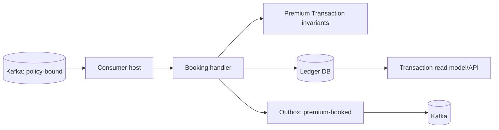

# Ledger components

Ledger is the financial-record owner. It consumes `policy-bound` and does not calculate eligibility or re-rate.

The booking transaction inserts the Inbox receipt, Premium Transaction, Premium Lines, Factor Lines, and `premium-booked` outbox row atomically. A unique business key handles semantically duplicate events with different event ids. Read APIs expose the immutable transaction and its factor-level explanation. The self-check verifies line totals and the last factor step; it never edits ledger rows.
