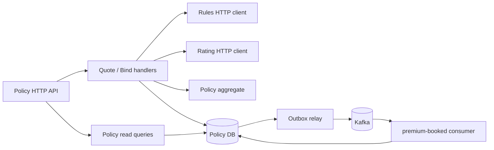

# Policy components

Policy owns the customer-facing workflow, policy terms, quote snapshots, bind state, and a local Booking Status projection.

Quote and bind are commands. Policy coordinates Rules and Rating but does not implement either domain capability. The bound revision, idempotency response, and outbox message commit together. The Booking Status update is a separate event-driven projection; a delayed Ledger does not roll back a bound policy.
