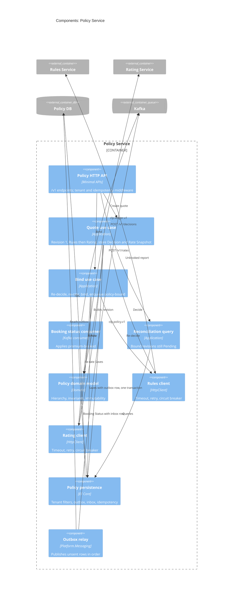

# Components: Policy Service

Structurizr view: `PolicyComponents`. Rules, Rating and Carrier are simple enough not to need a component view: each is an HTTP API over a domain model, with no database and no consumers.

Every service uses the same layering: `Api` depends on `Application`, `Application` depends on `Domain` and on ports it defines, `Infrastructure` implements those ports. `Domain` depends on nothing outside the BCL (enforced by architecture tests, NFR-21).

## What each box is

| Box | Role |
| --- | --- |
| Policy HTTP API | The only public entry. Versioned `/v1` routes, `X-Tenant-Id`, `Idempotency-Key` on state-changing posts, problem details for errors. |
| Quote use case | Builds Policy Revision 1 from the schedule, asks Rules then Rating, stores the Decision and Rate Snapshot, and enqueues `policy-quoted`. |
| Bind use case | Re-runs Rules and Rating, assigns the policy number, binds the revision, and enqueues `policy-bound` in the same SQL transaction as the bind. |
| Booking status consumer | Reads `premium-booked` and sets Booking Status on the bound revision. Idempotent via the inbox. |
| Reconciliation query | Lists bound revisions whose Booking Status is still Pending, so an operator can see bookings that have not caught up. |
| Policy domain model | Account, Policy, Policy Revision and the Location, Building, Unit, Coverage, Exposure hierarchy. Bound revisions are immutable. No EF, Kafka or ASP.NET. |
| Rules client / Rating client | Typed HTTP clients. Timeout, retry and circuit breaker live here so the use cases stay free of transport. |
| Policy persistence | EF Core DbContext: tenant query filters, outbox, inbox, idempotency. The only component that talks to Policy DB. |
| Outbox relay | Hosted service. Publishes unsent outbox rows to `clp.policy.v1` in order, then marks them published. Request handlers never publish to Kafka. |
| Rules Service, Rating Service | Outside this boundary. Policy calls them synchronously because the broker is waiting for a Decision and a price. |
| Policy DB | This service's own SQL Server. Accounts, policies, revisions, decisions, rate snapshots, outbox, inbox, idempotency. |
| Kafka | The event log. The relay writes `policy-quoted` and `policy-bound`; the booking consumer reads `premium-booked`. |

## Project mapping

| Component | Project |
| --- | --- |
| Policy HTTP API | `Policy.Api` |
| Quote, Bind, Booking status, Reconciliation | `Policy.Application` |
| Policy domain model | `Policy.Domain` |
| Rules and Rating clients, persistence, consumer host | `Policy.Infrastructure` |
| Outbox relay, inbox, idempotency, tenancy | `Platform.*` |
