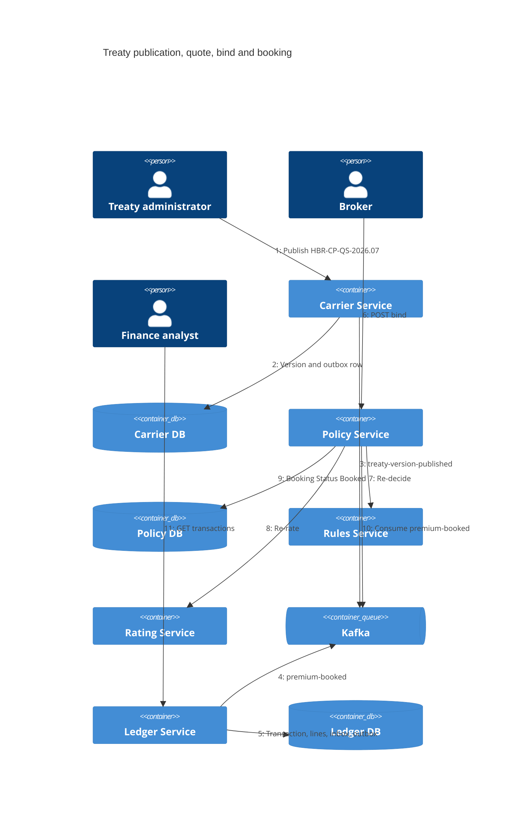
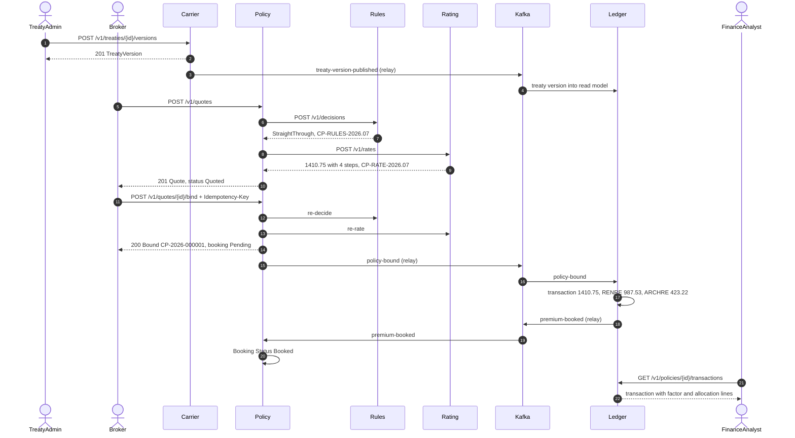

# Dynamic view: quote, bind, book

Structurizr view: `QuoteBindBook`. Scenario values: [../../specs/product/user-flow.md](../../specs/product/user-flow.md#reference-scenario).

The numbered arrows are one walk of the reference scenario, not a second architecture. Treaty publication happens first so Ledger already holds the Treaty Version when `policy-bound` arrives. Quote and bind are synchronous HTTP through Policy, Rules and Rating. Booking is asynchronous: Policy commits the bind, the outbox relay publishes, Ledger appends the Premium Transaction, then Policy marks Booking Status Booked.

The sequence diagram below is the same walk with return values filled in (Decision, premium `1410.75`, allocation). It is the readable form of the C4 dynamic view.

## Sequence

## Failure behaviour along the path

| Failure | Effect | Recovery |
| --- | --- | --- |
| Rules or Rating down during quote or bind | `503 dependency-unavailable`; nothing stored | Client retries with the same idempotency key |
| Policy crashes after commit, before relay publish | Outbox row unsent | Relay publishes on restart |
| Relay crashes after publish, before marking | Event published twice | Ledger inbox drops the duplicate |
| Kafka down | Bind still succeeds; booking waits | Relay resumes; Booking Status catches up |
| Ledger down | Booking waits | Consumer resumes from its committed offset |
| Treaty Version not yet in Ledger | Retries, then dead-letter | Re-drive after the treaty arrives ([operations.md](operations.md)) |
| Carrier down | No effect on quote, bind or booking | n/a |
