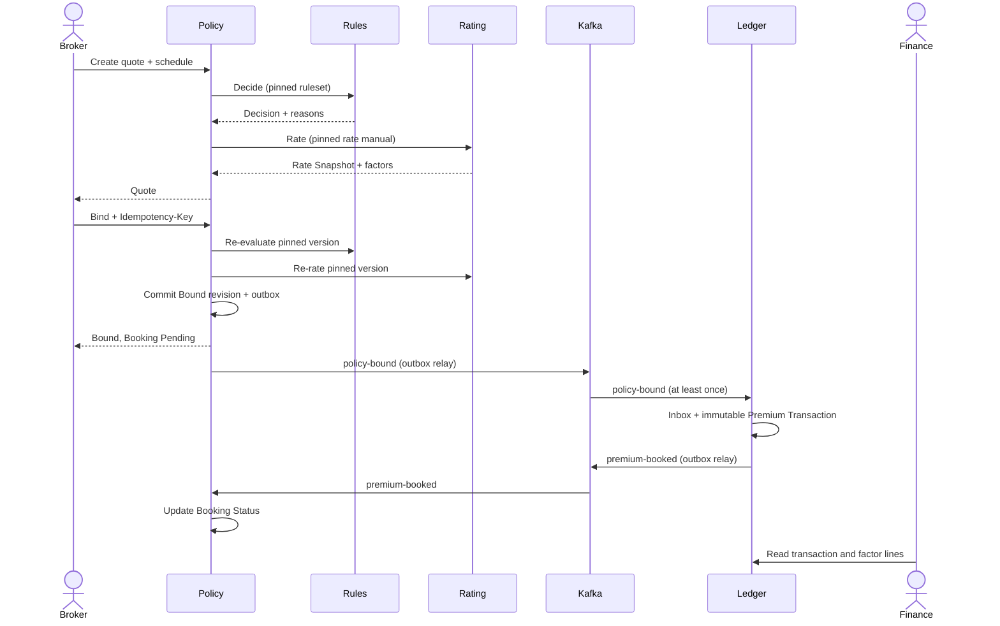

# Dynamic view: quote, bind and book

## Transaction boundaries

- Quote: Policy stores the revision and snapshots after successful Rules and Rating calls. Rules and Rating remain stateless for request data.
- Bind: Policy commits bound state and `policy-bound` outbox row atomically. Kafka is not part of the request transaction.
- Booking: Ledger commits its Inbox receipt, immutable financial rows, and `premium-booked` outbox row atomically.
- Confirmation: Policy consumes `premium-booked` idempotently and updates Booking Status. A temporary delay leaves the status Pending; it does not undo the bound policy.

`policy-bound` carries all facts Ledger needs, including the complete Rate Snapshot and hierarchy identifiers. This makes booking independent of Policy and Rating availability after bind and preserves the exact bound price for audit.
