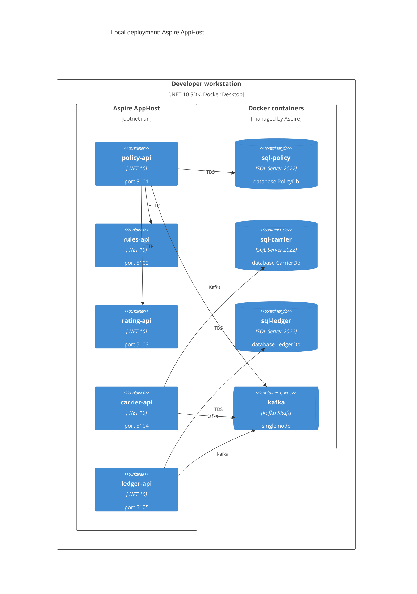

# Deployment: local, orchestrated by .NET Aspire

Structurizr view: `LocalDeployment`. Requirements: NFR-16, NFR-17, NFR-28. Decision: [ADR-0014](../adr/0014-aspire-apphost-for-local-orchestration.md).

`src/AppHost` defines the whole local topology in C#. `dotnet run --project src/AppHost` starts the service projects as processes, the infrastructure as containers, and the Aspire dashboard.

## Resources

| AppHost resource | Kind | Port | Notes |
| --- | --- | --- | --- |
| `policy-api` | project `Policy.Api` | 5101 | references `policy-db`, `kafka`, `rules-api`, `rating-api` |
| `rules-api` | project `Rules.Api` | 5102 | no references |
| `rating-api` | project `Rating.Api` | 5103 | no references |
| `carrier-api` | project `Carrier.Api` | 5104 | references `carrier-db`, `kafka` |
| `ledger-api` | project `Ledger.Api` | 5105 | references `ledger-db`, `kafka` |
| `sql-policy` / `policy-db` | SQL Server 2022 container and database | host 14331 | own container, data volume, memory limit 2 GB |
| `sql-carrier` / `carrier-db` | SQL Server 2022 container and database | host 14332 | as above |
| `sql-ledger` / `ledger-db` | SQL Server 2022 container and database | host 14333 | as above |
| `kafka` | Kafka container, KRaft | host 9092 | topics created at start from the events catalog, including dead-letter topics |
| `kafka-ui` | Kafbat UI container | 8085 | topic and consumer group browser |
| `structurizr` | `structurizr/lite` container | 8086 | bind-mounts `docs/architecture` |
| dashboard | Aspire dashboard | printed at start | traces, metrics, logs, resource health, start and stop per resource |

Parameters: `sql-policy-password`, `sql-carrier-password`, `sql-ledger-password` (secret, generated on first run into user secrets), plus owner and runtime login passwords per database. Tenants are configuration of each API.

Start order uses `WaitFor`: SQL Server healthy, Kafka healthy and topics created, then the services. Each API applies its own migrations on start with its owner login (NFR-29), then serves with its runtime login.

## Database isolation

Aspire puts every resource on one container network, so isolation does not rely on networks. It relies on four things, each tested:

| Mechanism | Test |
| --- | --- |
| A service project is given a reference to its own database resource only, so it has only that connection string | Architecture test over the AppHost model: every `*-db` resource has exactly one referencing service, and it is the owner |
| Separate SQL Server instances, so there is no cross-database query path | Acceptance test: `Policy` login cannot connect to `sql-ledger`; a login for one instance is rejected by another |
| Distinct credentials per database; runtime login has no rights outside its database | Acceptance test: runtime login cannot read the other schemas |
| Ledger runtime login is denied `UPDATE` and `DELETE` on ledger tables | Ledger test (NFR-11) |

## Acceptance tests

`tests/Acceptance.Tests` starts the AppHost with `Aspire.Hosting.Testing` (`DistributedApplicationTestingBuilder`), waits for every resource to be healthy and drives the HTTP APIs with the resource-provided endpoints. The same topology the developer runs is the one under test. Chaos checks stop and start resources through the Aspire resource commands or the container runtime ([operations.md](operations.md#chaos-checks-used-by-acceptance-tests)).

## Production mapping (not part of the MVP)

| Local | Azure target |
| --- | --- |
| SQL Server container per service | Azure SQL Database per service, zone redundant, point-in-time restore |
| Kafka container | Azure Event Hubs (Kafka protocol) or Confluent Cloud (ADR-0009) |
| Shared container network, credentials per database | VNet with private endpoints per database, managed identities |
| AppHost | Azure Container Apps through `azd` or AppHost publishing; the AppHost model is the starting point, not a deliverable of the MVP |
| `X-Tenant-Id` header | Entra ID / OIDC token tenant claim, validated at API Management |
| Aspire dashboard | Azure Monitor, Application Insights |
