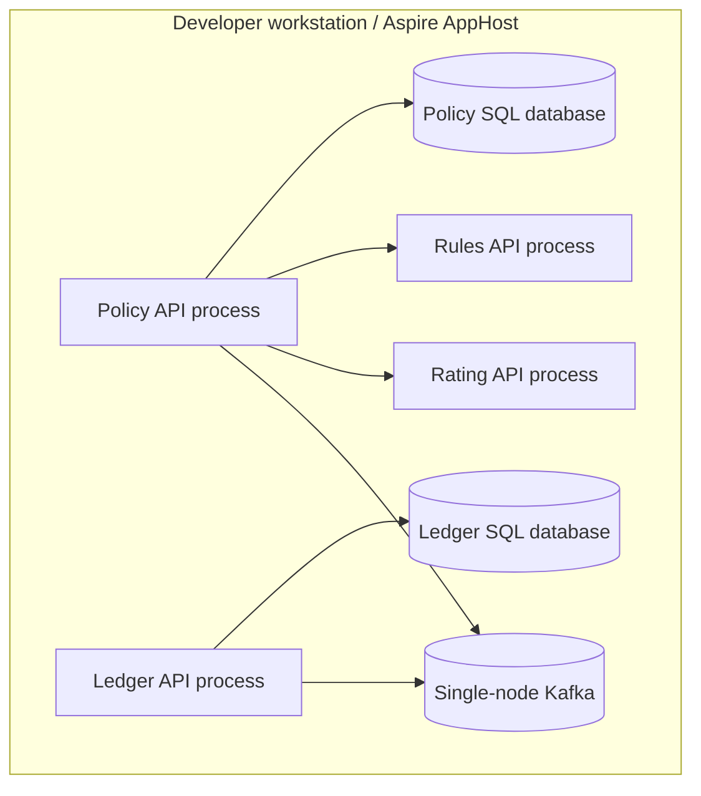

# Deployment views

## Local learning topology

The local topology is a developer convenience and an integration-test environment. It is not a production topology.

Rules and Rating have no business database. Policy and Ledger use separate databases and credentials. AppHost owns local resource wiring; service code reads configuration and does not depend on Aspire hosting APIs.

## Future Azure mapping

The following is a target to evaluate, not a deployment commitment or an implemented production environment.

| Capability | Azure direction | Design point to validate |
| --- | --- | --- |
| Service runtime | Azure Container Apps or AKS | Operational ownership, scaling and network topology |
| Policy/Ledger databases | Separate Azure SQL databases | Private endpoints, managed identity, zone redundancy, PITR and restore objectives |
| Kafka-compatible backbone | Event Hubs Kafka endpoint or managed Kafka | Kafka feature compatibility, partitioning, retention, replay and consumer operations |
| Ingress and identity | API Management with Entra ID/OIDC | Tenant identity from validated claims, authorization and API lifecycle |
| Secrets | Key Vault with managed identity | Rotation and secretless service access |
| Telemetry | Azure Monitor / Application Insights via OpenTelemetry | Trace propagation through HTTP and messaging; data retention and cost |
| Delivery | CI/CD with IaC and environment promotion | Independent service releases, contract checks, rollback and migrations |

Production targets from the vacancy (99.9% availability, RPO <= 15 minutes, RTO <= 4 hours) require workload assumptions, a failure-mode design, and recovery exercises before they can be treated as requirements.
