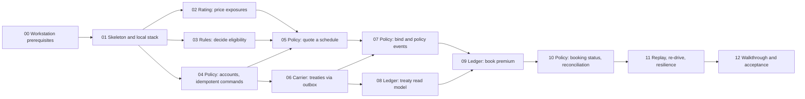

# Implementation plan

Status: accepted. Builds the MVP specified in [../product/](../product/) against the contracts in [../contracts/](../contracts/) and the architecture in [../../docs/architecture/](../../docs/architecture/).

## How we work

Spec-driven, test-first, one ticket at a time per branch (workflow in [AGENTS.md](../../AGENTS.md#spec-driven-workflow)):

1. Pick a ready ticket from the frontier (all blockers `done`).
2. Read the requirements it cites. If a spec or contract is wrong or missing, fix that first in the same branch.
3. Write a failing test named after the criterion, make it pass, refactor.
4. Update the traceability row, set the ticket to `done`.

### Definition of done for every ticket

- [ ] Every acceptance criterion has a passing test whose name starts with the requirement id.
- [ ] Responses validate against the OpenAPI file; produced events validate against their JSON Schema.
- [ ] Architecture tests pass (no forbidden references, no cross-service projects, tenant filters on every entity).
- [ ] `dotnet build` has no warnings; `dotnet test` (excluding Acceptance) passes.
- [ ] `dotnet run --project backend/src/AppHost` starts with every resource healthy.
- [ ] Specs, contracts, `workspace.dsl` and view pages updated if behaviour or structure changed; ADR added if the change meets the ADR bar.
- [ ] [traceability.md](../traceability.md) rows updated.

## Milestones

| Milestone | Tickets | Outcome |
| --- | --- | --- |
| M0 Workstation | 00 | Tools installed, repository initialised |
| M1 Foundations | 01 | AppHost running five healthy services, three SQL Servers, Kafka, architecture tests |
| M2 Quote path | 02, 03, 04, 05 | A broker gets a priced, decided quote |
| M3 Money path | 06, 07, 08, 09, 10 | Bind books premium with allocation; Policy shows Booked |
| M4 Hardening | 11, 12 | Replay, re-drive, chaos checks, end-to-end walkthrough, traceability complete |

## Ticket graph

After 01, tickets 02, 03 and 04 can run in parallel; after 04, ticket 06 runs alongside 05.

| # | Ticket | Blocked by | Requirements |
| --- | --- | --- | --- |
| 00 | [Workstation prerequisites](tickets/00-workstation-prerequisites.md) | none | P-6 |
| 01 | [Skeleton and local stack](tickets/01-skeleton-and-local-stack.md) | 00 | FR-13.1, FR-16, NFR-9, NFR-16, NFR-17, NFR-19, NFR-21, NFR-22, NFR-24 to NFR-29 |
| 02 | [Rating: price exposures](tickets/02-rating-price-exposures.md) | 01 | FR-5, NFR-2, NFR-10 |
| 03 | [Rules: decide eligibility](tickets/03-rules-decide-eligibility.md) | 01 | FR-3.1 to FR-3.3, FR-4 |
| 04 | [Policy: accounts and idempotent commands](tickets/04-policy-accounts-idempotent-commands.md) | 01 | FR-1, FR-13, FR-14, FR-17.1, NFR-20 |
| 05 | [Policy: quote a schedule](tickets/05-policy-quote-a-schedule.md) | 02, 03, 04 | FR-2, FR-3.2, FR-3.4, FR-6, FR-17.1, NFR-8, NFR-14 |
| 06 | [Carrier: treaties published through the outbox](tickets/06-carrier-treaties-via-outbox.md) | 04 | FR-8, FR-15.1, FR-15.2, FR-15.6, FR-17.2, NFR-13 |
| 07 | [Policy: bind and policy events](tickets/07-policy-bind-and-events.md) | 05, 06 | FR-7, FR-15.1, NFR-13 |
| 08 | [Ledger: treaty read model](tickets/08-ledger-treaty-read-model.md) | 06 | FR-9.1, FR-9.2, FR-15.3 to FR-15.5 |
| 09 | [Ledger: book premium](tickets/09-ledger-book-premium.md) | 07, 08 | FR-10, FR-13.5, FR-17.3, NFR-10 to NFR-12, NFR-15 |
| 10 | [Policy: booking status and reconciliation](tickets/10-policy-booking-status-reconciliation.md) | 09 | FR-11, FR-12 |
| 11 | [Replay, re-drive and resilience](tickets/11-replay-redrive-resilience.md) | 10 | FR-9.3, FR-15.5, NFR-5 to NFR-7, NFR-23, NFR-30 |
| 12 | [Walkthrough and end-to-end acceptance](tickets/12-walkthrough-and-acceptance.md) | 11 | user flow A1 to A13, NFR-1 to NFR-4, NFR-18 |

## Technology choices

| Concern | Choice |
| --- | --- |
| Runtime | .NET 10 (LTS), C# latest, nullable, warnings as errors, central package management (`Directory.Packages.props`) |
| HTTP | ASP.NET Core Minimal APIs, `Asp.Versioning.Http`, built-in problem details |
| Persistence | EF Core 10 with SQL Server provider, migrations per service |
| Messaging | `Confluent.Kafka` behind `Platform.Messaging` |
| JSON Schema | `JsonSchema.Net` for NAICS validation at runtime and event and OpenAPI validation in tests |
| Resilience | `Microsoft.Extensions.Http.Resilience` |
| Observability | OpenTelemetry .NET (ASP.NET Core, HttpClient, EF Core, custom Kafka spans), OTLP exporter, JSON console logs |
| Tests | xUnit v3, Shouldly, `Microsoft.AspNetCore.Mvc.Testing`, Testcontainers (MsSql, Kafka), NetArchTest |
| Local orchestration | .NET Aspire (AppHost, ServiceDefaults in `Platform.Web`, `Aspire.Hosting.SqlServer`, `Aspire.Hosting.Kafka`, `Aspire.Hosting.Testing`), Docker Desktop for containers; ADR-0014 |
| Container images | .NET SDK container publishing (`PublishContainer`) per service |
| Architecture docs | Structurizr DSL served by Structurizr Lite (an AppHost resource), Mermaid copies in markdown |

## Test strategy

| Layer | What it proves | Runs against |
| --- | --- | --- |
| Domain unit tests | Invariants, rounding, allocation, rule evaluation, immutability | in memory |
| Service integration tests | Endpoints, persistence, outbox and inbox, tenant filters, contract conformance | `WebApplicationFactory` plus Testcontainers SQL Server and Kafka |
| Architecture tests | Dependency rules and guardrails | compiled assemblies |
| Acceptance tests (`Category=Acceptance`) | User flow, tenant isolation, database isolation, chaos checks, latency targets | the stack started by `Aspire.Hosting.Testing` |

Test only through public behaviour: HTTP endpoints, published events, consumed events. No tests of private methods or EF internals.

## Risks

| Risk | Mitigation |
| --- | --- |
| Three SQL Server containers exceed laptop memory | Memory limits on the AppHost container resources; ticket 00 checks Docker has 10 GB; ADR-0001 records the trade-off |
| Testcontainers runs slow with SQL Server | One container per test class fixture, shared across tests; reset by tenant id rather than recreating |
| Outbox relay ordering under failure | Relay stops at the first failed row; tested with Kafka stopped mid-batch (ticket 11) |
| Contract drift | Services serve the spec file itself; contract tests validate live responses |
| Mermaid copies drift from `workspace.dsl` | Definition of done includes both; review checks the pair |
