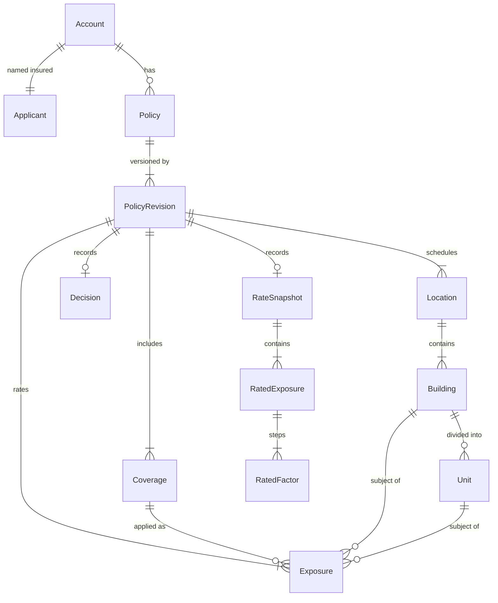
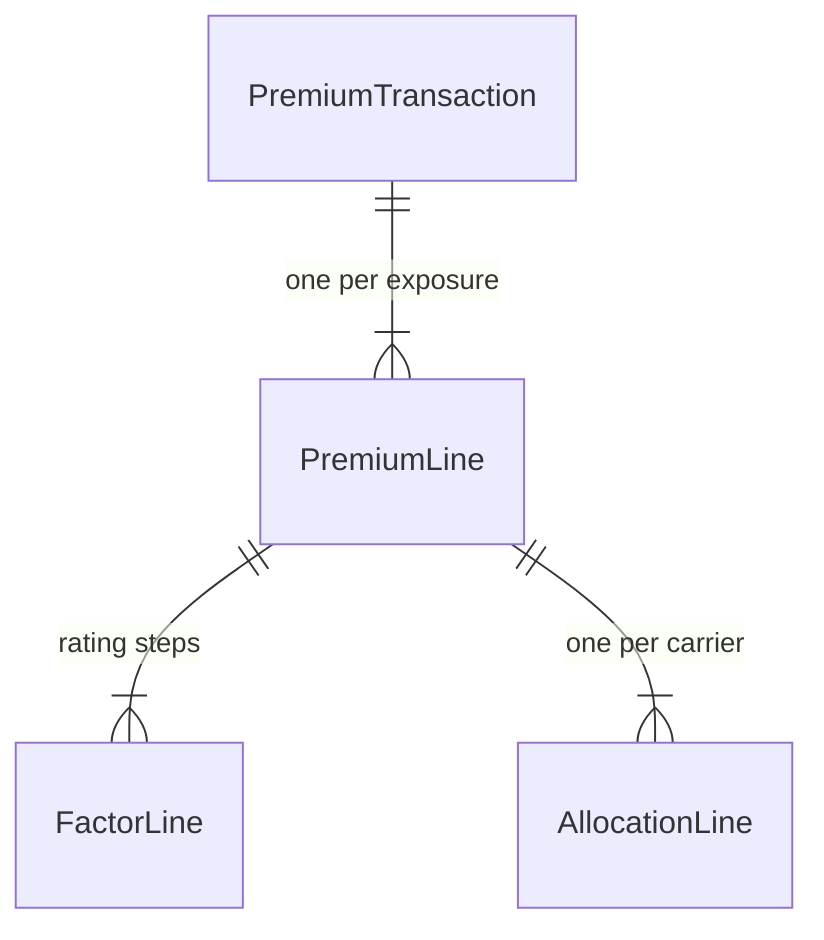

# Data model

Status: accepted, MVP scope. Terms as in [../../GLOSSARY.md](../../GLOSSARY.md).

Each service owns its data in its own SQL Server instance and database. Nothing below is shared between services; data crosses a boundary only through an API call or an event.

## Common conventions

- Ids are `uniqueidentifier`, generated in the application as version 7 GUIDs (time-ordered).
- Every table has `TenantId varchar(32) not null` and every index that serves a query leads with it.
- Money columns are `decimal(19,4)`; rates and factors `decimal(19,8)`; shares `decimal(7,4)` (percent).
- `CreatedAt datetime2(3)` in UTC on every row. Effective dates are `date`.
- Each service database has a schema named after the service (`policy`, `carrier`, `ledger`) plus a `messaging` schema for `OutboxMessage`, `InboxMessage` and `IdempotencyRecord`.

## Commercial hierarchy (Policy service)

Ordering of the hierarchy follows the business view Account, Applicant, Policy, Coverage, Location, Building, Unit, Exposure. Coverage and the Location tree hang off the Policy Revision side by side; Exposure joins them.

| Entity | Key fields | Notes |
| --- | --- | --- |
| Account | Id, TenantId, Name | Aggregate root, separate from Policy |
| Applicant | Id, AccountId, LegalName, Fein, MailingAddress | One per Account in MVP |
| Policy | Id, TenantId, AccountId, PolicyNumber (null until bound), LineOfBusiness `CP` | Aggregate root; owns its revisions and everything below them |
| PolicyRevision | Id, PolicyId, RevisionNo, Status, EffectiveFrom, EffectiveTo, QuotedAt, QuoteExpiresAt, BoundAt, BookingStatus, TransactionId, BookedAt | Status: `Quoted`, `Referred`, `Declined`, `Bound`. BookingStatus: `NotApplicable`, `Pending`, `Booked` |
| Coverage | Id, RevisionId, Code `BLDG`, Deductible | |
| Location | Id, RevisionId, Street, City, State, PostalCode, ProtectionClass | |
| Building | Id, LocationId, Construction, YearBuilt, SquareFeet | |
| Unit | Id, BuildingId, UnitNumber, SquareFeet, Description | |
| Exposure | Id, RevisionId, CoverageId, BuildingId or UnitId (exactly one), Limit, NaicsCode, ExtensionSchema, ExtensionData (json) | Rated unit |
| Decision | RevisionId, Outcome, RulesetVersion, Reasons (json array of code, exposureId) | One per revision |
| RateSnapshot | RevisionId, RateManualVersion, WrittenPremium | One per revision when priced |
| RatedExposure | RevisionId, ExposureId, BaseRate, Premium | |
| RatedFactor | RevisionId, ExposureId, Step, FactorCode, FactorValue, PremiumAfter | Step 0 is `BASE_RATE` |
| PolicyNumberSequence | TenantId, Year, NextValue | Allocated inside the bind transaction |

Rules enforced in the domain model:

- Revisions are numbered from 1 per Policy. MVP creates only revision 1.
- A revision with status `Bound` rejects every mutation.
- An Exposure's Building or Unit belongs to the same revision.

### Effective dating

- `PolicyRevision.EffectiveFrom` and `EffectiveTo` are valid-time: when the coverage applies. `CreatedAt`, `QuotedAt` and `BoundAt` are system time: when we recorded it.
- A later endorsement will be a new revision with its own effective range over the same term; earlier bound revisions stay unchanged. The schema supports it; MVP does not expose it.
- Treaty Versions are effective-dated the same way, and Ledger selects one by the policy effective date, not by booking time.

### NAICS Extensions

The extension payload is stored as JSON in `Exposure.ExtensionData` with its schema id in `ExtensionSchema` (for example `naics/531110.v1`). Schemas live in [../contracts/naics/](../contracts/naics/) and are owned by Rules. Adding a NAICS code or a schema version needs no Policy migration.

| Schema | Fields |
| --- | --- |
| `naics/531110.v1` Lessors of buildings | `unitCount` (1-500), `percentVacant` (0-100), `hasRestaurantTenant` (bool) |
| `naics/722511.v1` Full-service restaurants | `cookingType` (`None`, `Grill`, `DeepFry`), `hoodSuppression` (bool), `seatingCapacity` (1-2000) |

## Carrier service

| Entity | Key fields | Notes |
| --- | --- | --- |
| Carrier | Code (PK), Name | Global reference data, seeded: `RENRE` Renaissance Re, `ARCHRE` Arch Re |
| Treaty | Id, TenantId, Name, LineOfBusiness | Aggregate root |
| TreatyVersion | Id, TreatyId, VersionCode, EffectiveFrom, PublishedAt | Immutable once inserted. Unique (TreatyId, EffectiveFrom) and (TenantId, VersionCode) |
| TreatyShare | TreatyVersionId, CarrierCode, SharePercent | Sum per version is exactly 100 |

## Ledger service

### Treaty read model

Filled only from `treaty-version-published`.

| Entity | Key fields |
| --- | --- |
| TreatyVersionView | TreatyVersionId (PK), TenantId, TreatyId, LineOfBusiness, VersionCode, EffectiveFrom, SourceEventId |
| TreatyShareView | TreatyVersionId, CarrierCode, CarrierName, SharePercent |

### Premium ledger (insert-only)

| Entity | Key fields | Notes |
| --- | --- | --- |
| PremiumTransaction | Id, TenantId, PolicyId, PolicyNumber, RevisionNo, TransactionType `NewBusiness`, EffectiveDate, WrittenPremium, Currency `USD`, TreatyVersionId, RateManualVersion, RulesetVersion, SourceEventId, BookedAt | Unique (TenantId, PolicyId, RevisionNo, TransactionType) |
| PremiumLine | Id, TransactionId, ExposureId, CoverageCode, LocationId, BuildingId, UnitId, NaicsCode, Limit, Premium | |
| FactorLine | PremiumLineId, Step, FactorCode, FactorValue, PremiumAfter | Copied from the bound Rate Snapshot |
| AllocationLine | PremiumLineId, CarrierCode, SharePercent, Amount, IsLead | Sum of Amount per PremiumLine equals Premium |

A future correction is a new transaction (for example `Correction` or `Endorsement`) with signed amounts; existing rows are never changed.

## Messaging tables (every stateful service)

| Table | Key fields | Notes |
| --- | --- | --- |
| OutboxMessage | Sequence (identity, PK), EventId, Topic, Key, Type, Payload, Headers, CreatedAt, PublishedAt | Relay reads unpublished rows by Sequence |
| InboxMessage | Consumer, EventId (PK pair), ProcessedAt | Written with the effect |
| IdempotencyRecord | TenantId, Operation, Key (PK), RequestHash, StatusCode, ResponseBody, State, CreatedAt, ExpiresAt | State: `InFlight`, `Completed` |
| AggregateSequence | AggregateType, AggregateId (PK pair), LastSeq | Source of `aggregateSeq` for events, incremented in the same transaction |

Rules and Rating have no database.
