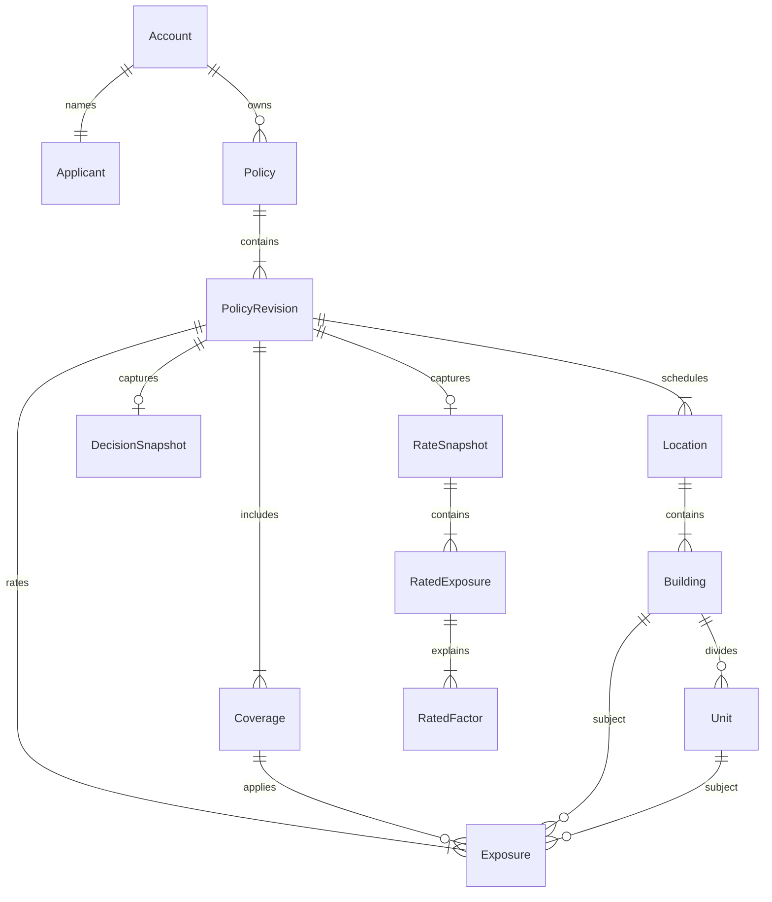
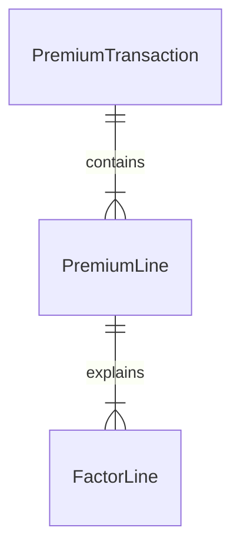

# Data ownership and domain model

Status: proposed learning scope. Each stateful context owns its database. Cross-context data moves through contracts and events, never cross-service SQL.

## Bounded contexts

| Context | Owns | Persistence |
| --- | --- | --- |
| Policy | Account, Applicant, Policy, Policy Revision, Quote, Decision snapshot, Rate Snapshot reference/data, bind state and Booking Status projection | SQL Server |
| Rules | Eligibility policy and versioned rulesets; no quote outcomes | Versioned configuration artifact; no business database |
| Rating | Pricing model and versioned Rate Manuals; no quote outcomes | Versioned configuration artifact; no business database |
| Ledger | Immutable Premium Transactions, Premium Lines, Factor Lines, consumer Inbox and its outbox | SQL Server |

Rules and Rating are separate because eligibility and price have different business responsibilities, release cadence, and correctness rules. Policy owns the workflow and invokes both synchronously. Ledger owns the financial record and consumes the immutable bound snapshot asynchronously.

## Policy context

Exposure references exactly one Building or Unit. Coverage, schedule, and Exposure references must belong to the same revision. In MVP the Policy aggregate owns revision 1 and its bound terms become immutable at bind. `PolicyBookingStatus` is a separate Policy-owned projection keyed by tenant, Policy, and revision. Policy creates it as Pending in the bind transaction, then updates it to Booked when it consumes `premium-booked`.

Ruleset and Rate Manual versions are pinned when the Quote is created. Bind re-evaluates using those versions. If an immutable version has been retired and is unavailable, bind fails safely; it does not silently use a newer version.

NAICS extension schemas are versioned contracts in [../contracts/naics/](../contracts/naics/). Extension data belongs to an Exposure. Avoid duplicating schedule facts such as the count of Units in extension data unless Rules has a defined business use for that independently supplied value.

## Ledger context

| Entity | Key facts | Invariant |
| --- | --- | --- |
| PremiumTransaction | tenant, policy, revision, transaction type, written premium, currency, ruleset/rate-manual versions, source event id, booked timestamp | Unique `(tenantId, policyId, revisionNo, transactionType)`; append-only |
| PremiumLine | exposure and hierarchy identifiers, Coverage, limit, premium | One per Exposure in the bound snapshot |
| FactorLine | factor order, code, value, premium after step | Copied from bound Rate Snapshot; final step equals line premium |

The `policy-bound` event carries the complete immutable Rating Snapshot so Ledger can book without synchronous calls to Policy or Rating. Ledger does not own Policy terms; it stores identifiers and financial facts required for audit.

## Messaging and command support

Policy and Ledger have local `OutboxMessage`, `InboxMessage`, and idempotency records as needed. Outbox and aggregate sequence state are committed with the owning aggregate change. Inbox receipt and consumer effect are committed together. These are technical persistence concerns, not domain concepts.

## Time and money

Policy term dates are valid-time dates. `QuotedAt`, `BoundAt`, and `BookedAt` are UTC system timestamps. Money is decimal in application code, `decimal(19,4)` in SQL, and a decimal string in event/API JSON. Rounding rules are defined in [rules-and-rating.md](rules-and-rating.md).
